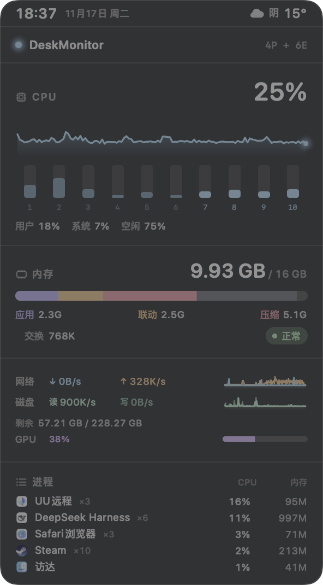

# koi's deskmonitor

macOS 桌面悬浮监控面板：CPU、内存、网络、磁盘、GPU、进程、天气，外加 DSH 任务进度。

常驻桌面右上角（或任意位置），半透明毛玻璃，不抢焦点。



## 功能

- **CPU**：总占用、每核心柱状图、用户/系统/空闲分解、实时曲线
- **内存**：已用/总量、应用/联动/压缩分段、交换用量、内存压力
- **网络 / 磁盘**：实时吞吐与曲线
- **GPU**：利用率
- **进程**：按占用排序，CPU 与内存两列
- **时间 / 日期 / 天气**：天气来自 Open-Meteo，可按城市或经纬度设置
- **DSH 任务**：显示当前工作区各会话的待办进度
- **简约模式**：双击面板切换成 104×104 方块，只留时间、CPU、内存

## 系统要求

- macOS 14 (Sonoma) 或更高
- Apple Silicon（M1 及以后）

## 安装

从 Releases 下载 `DeskMonitor-x.y.z.zip`，解压后拖进「应用程序」。

**首次打开**：应用是本地 ad-hoc 签名，macOS 会提示「无法验证开发者」。两种方式放行：

```bash
# 方式一：右键点击 App → 打开 → 再点一次「打开」
# 方式二：终端执行
xattr -d com.apple.quarantine /Applications/DeskMonitor.app
```

## 从源码构建

```bash
git clone <repo>
cd DeskMonitor
./build.sh release
open build/DeskMonitor.app
```

`build.sh` 会自动组装 `.app`、打包使用说明、做 ad-hoc 签名。

> 构建脚本在 `/tmp` 里签名再拷回，因为部分工作目录被 File Provider 接管时，
> `codesign` 会因 `com.apple.FinderInfo` 反复写入而失败。

## 使用

| 操作 | 方式 |
|---|---|
| 拖动面板 | 按住时间行或标题行拖 |
| 调整大小 | 拖右下角 |
| 切换简约模式 | 双击面板 |
| 全部功能 | 右键菜单栏图标 |
| 退出 | 菜单 → 退出 DeskMonitor |

## 说明

- 面板位置、尺寸、模块开关、刷新间隔等设置全部保存在本机
- 除天气外不发起任何网络请求，无遥测、无上传
- 天气数据来自 [Open-Meteo](https://open-meteo.com/)（非商业免费，需保留署名）

## 已知限制

- 无告警通知（阈值提醒未实现）
- 吸附目前贴屏幕边缘；贴 DSH 窗口边缘的检测在部分场景下会退化
- 仅 Apple Silicon；未做 Intel 支持
- 天气地名库缺少部分县级地名，可用经纬度绕开

## 许可证

[MIT](LICENSE)
